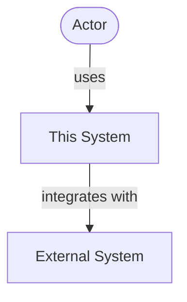
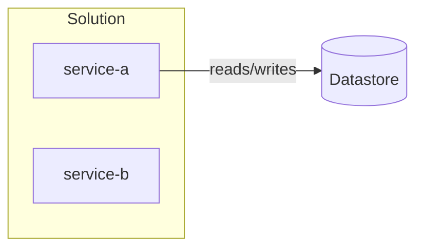
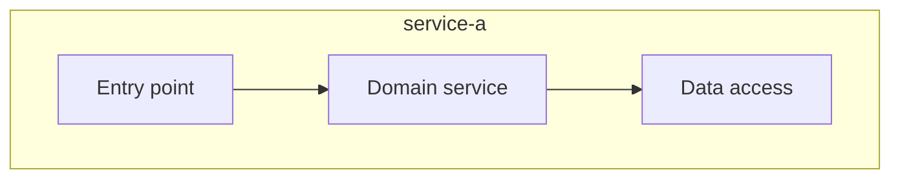
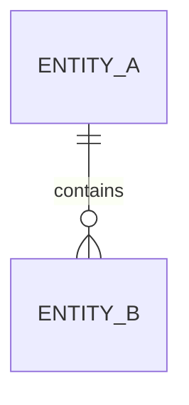

# Living Architecture Specification

> Authoritative structural map of this system. Refresh the diagrams to match the repo as it now
> stands. Every diagram MUST be valid and actually render -- check bracket, quote, fence, and
> subgraph balance. Draw what EXISTS as live; draw planned components dashed and labelled PLANNED.
> Structural only: functional behavior belongs in the product specification.

## 1. System Context (C1)
<!-- Users, external systems, and the boundary of this system. -->

## 2. Containers (C2)
<!-- Deployable units, datastores, and brokers, with the protocol on each edge. -->

## 3. Components (C3)
<!-- Internal domain components inside each container. -->

## 4. Data Model (C4)
<!-- Persisted entities and their relationships. -->

## 5. Inventories
<!-- Keep current, including entries a change REMOVED. -->

### Persistence
| Entity / table | Owner component | Notes |
| :-- | :-- | :-- |

### Interfaces
| Interface / endpoint | Method | Contract | Status |
| :-- | :-- | :-- | :-- |

### Messaging
| Channel / topic | Direction | Payload | Consumer |
| :-- | :-- | :-- | :-- |

## 6. Cross-Cutting Decisions

| Decision | Choice | Decided by |
| :-- | :-- | :-- |

## 7. Non-Functional Telemetry
<!-- Append; do not discard historic entries. Mark unmeasured figures as TARGET, never observed. -->

| Metric | Value | Target or Observed | Build / host | Date |
| :-- | :-- | :-- | :-- | :-- |

## 8. Architecture Change Log

| Change | Date | Structural impact |
| :-- | :-- | :-- |
